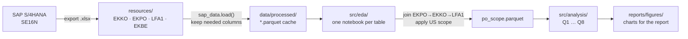

# Global Bike: US procurement analysis 2026

Analysis of Global Bike's US purchasing (SAP training client, company code / purchasing org **US00**)
for Antonio Rodriguez, head of Operations. It shows which suppliers, regions, months and materials
drive purchasing value, and what extra data is needed before changing a supplier relationship.

**Scope:** purchase orders only (category F, deleted items excluded) · Document Date **Oct 2025 – Sep 2026**
(last 12 complete months) · USD · measure = **Net PO value** (ordered value, not invoiced spend) ·
**884 PO items, 758 POs, 291 suppliers, $3.06M**.

## Workflow



1. **Extract**: SE16N exports of EKKO (PO header), EKPO (PO item), LFA1 (supplier master) and EKBE (PO history), saved to `resources/`.
2. **Load & cache**: `src/sap_data.py` reads each Excel file once, keeps the useful columns and caches it as Parquet.
3. **EDA**: `src/eda/*_eda.ipynb` checks grain, missing values, document categories, currencies, dates and data quality for each table.
4. **Scope**: `src/eda/scope_eda.ipynb` joins the tables (with `validate="many_to_one"`), applies the US00 / PO / period filters and saves `po_scope.parquet`.
5. **Analyse**: `src/analysis/q1…q8` contain one notebook per question, each with a chart, a statistic and the limitation.

## Questions and answers

### Q1. Which suppliers hold the largest share, and how concentrated is spend?
**The top 10 suppliers hold 36% and the top 20% (58 suppliers) hold 70% of Net PO value.** Spend is
concentrated but not dominated by one supplier: the largest has 10%, and the HHI of 0.022 is like
having ~45 equal-sized suppliers. The ~87 A-class suppliers (80% of value) are where volume contracts
make sense.

 

### Q2. Where are suppliers located: domestic vs overseas?
**95% of value goes to US suppliers and 5% overseas (mostly DE and HU). By item count, overseas is 20%:
many small orders.** Within the US, Texas (24%) and Nebraska (21%) lead, but **45% of domestic value
has no state** in the supplier master.


 

### Q3. How did Net PO value and PO count change month by month?
**Purchasing is very uneven: 5 of 12 months have no POs at all.** Peaks fall in Oct 2025 ($867k, 336 POs)
and Apr–May 2026 ($1.09M in May). The coefficient of variation is 1.51. One year can't prove seasonality,
and the peaks follow university teaching terms in the training client.


### Q4. What is the split by material group, and who dominates the critical categories?
**SAP material group `UTIL` holds 95%, so the groups are too coarse.** Using derived categories:
accessories are 75% (chain locks alone 65%), finished bikes 3% and components 0.4%. **Finished bikes
depend on one supplier (85%)**, while accessories are spread across 259 suppliers (top supplier 6%).


### Q5. Which suppliers receive many small orders that could be consolidated?
**18 suppliers get ≥5 POs with a below-median value per PO (median $3,350).** Together they account for
14% of all POs but only 3.5% of value. Some average under $200 per PO, which makes them candidates for
long-term contracts with call-offs. 108 of 290 suppliers received only one PO.


### Q6. Does any receiving plant depend on a single supplier region?
**Both main plants buy ~95% from US suppliers** (Miami MI00 $2.91M, Dallas DL00 $139k). Miami is spread
across regions (largest 40%). Dallas appears 91% dependent, but only because those suppliers have **no
state recorded**, so the master data must be fixed first.


### Q7. How did unit prices of the top 5 materials develop (fixed-base and chain index)?
**Only chain locks, the main spend item, have a usable price series: stable at $32–35 per unit (index
98–108).** That supports a fixed-price contract. Water bottle, spelt flour and touring bike prices jump
by orders of magnitude because of a few exercise entries with made-up prices.


### Q8. How much value is single-sourced vs multi-sourced?
**It depends on the definition. By SAP material number, 63% of value is single-sourced. By product type,
only 2% is** (the water bottle cage). Every student created their own material number for the same
product (183 numbers for chain lock). The real single-source risks are the bottle cage and finished
bikes. Harmonising material numbers would make sourcing and price comparison possible.


## Limitations
- **Training data:** the SAP client is shared by students. Many suppliers are exercise records
  (`szállító…`, `Vendor`, `Bike supplier 000`), and activity follows class dates.
- **Measure:** Net PO value = ordered value. It isn't invoiced or paid spend, or total cost of ownership.
- **Outlier:** the largest item in the extract ($6.4M chain locks, Oct 2026) falls outside the window. With
  "all data" it alone would be 47% of value.
- **Geography:** location is the supplier master address, not the ship-from location, and 45% of US value
  has no state.
- **Missing data:** before changing a supplier relationship, Antonio needs quality data (inspection or
  rejection rates), delivery reliability (goods-receipt dates vs planned dates in EKET) and lifecycle cost.

## Repository

```
resources/            raw SE16N exports (never edit)
data/processed/       parquet cache + po_scope.parquet (gitignored)
reports/figures/      charts used above and in the Word report
src/
  sap_data.py         paths, scope constants, loaders, product-family mapping
  charts.py           shared matplotlib style + save()
  eda/                1. EDA: ekko, ekpo, lfa1, ekbe, scope (run scope_eda first)
  analysis/           2. q1 … q8, one notebook per question
```

**Run it:** `conda env create -f environment.yml`, `conda activate sap-analysis`, `nbstripout --install`,
then run `src/eda/scope_eda.ipynb` followed by any notebook in `src/analysis/`.
