# Global Bike procurement analysis 2026: final report

*Prepared for Antonio Rodriguez, Head of Operations, Global Bike Inc.*

| Setting | Agreed scope |
|---|---|
| Team and members | _________________________________________________ |
| US organizational scope | Company code **US00**, purchasing organization **US00** |
| Plant scope | All US plants on in-scope POs: **MI00** Miami, **DL00** Dallas, **SD00** San Diego |
| Reporting period | From **1 Oct 2025** to **30 Sep 2026** (last 12 complete months, by PO Document Date) |
| Currency and tools | Currency **USD**; tool **Python** (pandas, matplotlib, Jupyter) |

---

## 1. Questions and scope

### 1.1 Business context
Antonio's monthly procurement report lists many purchasing records but doesn't show patterns. Our
analysis turns the US purchase orders into comparisons that support the next procurement review. It
keeps Global Bike's product strategy (quality, performance, durability, innovation) and its
procurement strategy (long-term strategic suppliers, a diversified network, decisions on total cost of
ownership rather than price alone) in view.

### 1.2 Analytical questions
Each question specifies a population (US00 purchase orders), a period (the reporting window above), a
comparison and a measure.

| # | Dimension | Question | Decision it supports |
|---|---|---|---|
| Q1 | Supplier | Which top 10 suppliers account for the largest share of Net PO value, and what share is concentrated in the top 20% of suppliers? | Where volume negotiation and long-term contracts pay off; how dependent we are |
| Q5 | Supplier (order pattern) | How do suppliers differ in PO count and average net value per PO, and which receive many small orders that could be consolidated? | Which suppliers to move to contracts / scheduling agreements |
| Q2 | Geography | How are Net PO value and PO item volume distributed across supplier countries and US states, and what share relies on overseas vs domestic suppliers? | Whether the network matches the "globally diversified" strategy |
| Q6 | Geography (plant link) | For each US receiving plant, what share of its Net PO value comes from each supplier country/region, and does any plant depend on a single region? | Plant-level regional exposure |
| Q3 | Time | How have monthly Net PO value and PO count evolved over the last 12 complete months, and are there seasonal spikes? | Timing of negotiations and framework contracts |
| Q7 | Time (price) | How has the average unit price of the five highest-value materials changed month by month (fixed-base and chain indices)? | Whether fixed-price agreements are supported by price stability |
| Q4 | Additional variable: material | What is the breakdown of Net PO value by material group, and which suppliers dominate the critical, high-performance categories? | Where single suppliers control critical categories |
| Q8 | Additional variable: material (risk) | What share of Net PO value goes to single-sourced vs multi-sourced materials? | Where a second source is needed |

### 1.3 Definitions
- **Net PO value**: the value of ordered items (EKPO `Net Order Value`) in order currency. It measures
  purchasing *commitments* in the extracted snapshot. It is **not** invoiced spend, paid spend or total
  cost of ownership. All charts are labelled "Net PO value".
- **PO count**: distinct purchasing document numbers. **PO item count**: distinct document + item
  combinations. A PO with five items counts as 1 PO and 5 items.
- **Supplier share**: a supplier's Net PO value divided by total Net PO value within the same scope and
  currency.
- **Geography**: supplier **country and region (state)** come from the supplier master address
  (LFA1). They describe where the supplier is registered, not where goods ship from. **Receiving plant**
  (EKPO) describes where items are ordered *for*. Q2 uses the supplier address, and Q6 links the two.

### 1.4 Scope filters
| Filter | Rule | Reason |
|---|---|---|
| Document category | `Purch. Doc. Category = F` | Only purchase orders carry ordered value. RFQs (A) and contracts (K) always have value 0. |
| Deleted items | `Deletion Indicator` empty | Items flagged `L` are deleted. |
| Organization | `Purch. Organization = US00` | US scope is defined by the purchasing organization, not by supplier location, so overseas suppliers of US procurement stay in scope. |
| Period | Document Date in [2025-10-01, 2026-10-01) | October 2026 is still incomplete (the analysis was run on 22 Oct 2026). |
| Currency | USD | All in-scope items are USD. 6 items with a blank header currency belong to company code US00 (local currency USD) and have value 0. |

---

## 2. Data and method

### 2.1 Tables
All tables were extracted with transaction **SE16N** and exported to Excel.

| Table | Content | Grain (one row = …) | Rows × columns (raw) | Used for |
|---|---|---|---|---|
| EKKO | Purchasing document header | purchasing document | 3,803 × 195 | category, supplier, purch. org, company code, document date, currency |
| EKPO | Purchasing document item | document + item | 3,974 × 418 | Net Order Value, quantity, material, material group, plant |
| LFA1 | Supplier general data | supplier | 25,055 × 197 | supplier name, country, region, city |
| EKBE | PO history (goods/invoice receipts) | item × material/accounting document | 2,824 × 93 | data-quality check only (not used for Q1–Q8) |

Most raw columns are empty or constant. A check in each EDA notebook shows that only 37 EKKO, 56 EKPO
and 26 LFA1 columns hold more than one distinct value. We load only the 8–16 columns we need.

### 2.2 Workflow

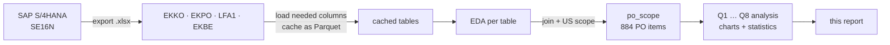

1. **Extract**: the four SE16N exports are stored unchanged in `resources/`.
2. **Load & cache** (`src/sap_data.py`): each Excel file is read once with only the needed columns
   and cached as Parquet. SE16N exported some headers twice. In EKKO the first `Purch. Organization`
   column is empty and the values sit in the duplicate column `Purch. Organization.1`, which we rename.
   Supplier keys are cast to text on both sides so the joins match.
3. **Exploratory data analysis** (`src/eda/`): one notebook per table checks grain, missing values,
   categories, value distribution, dates and data quality (Section 2.4).
4. **Scope** (`src/eda/scope_eda.ipynb`): join and filter, then save one in-scope table that every
   question uses, so all results share the same population.
5. **Analysis** (`src/analysis/q1 … q8`): one notebook per question, each giving a chart, a
   descriptive statistic, a finding and a limitation.

### 2.3 Key Python code
Join with integrity checks. `validate="many_to_one"` makes pandas raise an error if a key isn't unique
on the right side, so no item can be silently duplicated and no value double-counted:

```python
df = (ekpo.drop(columns=["Purch. Doc. Category", "Company Code"])
      .merge(ekko, on="Purchasing Document", how="left", validate="many_to_one")
      .merge(lfa1, on="Supplier", how="left", validate="many_to_one"))
assert len(df) == len(ekpo)
```

Scope filters:

```python
po = df[(df["Purch. Doc. Category"] == "F")
        & df["Deletion Indicator"].isna()
        & (df["Purch. Organization"] == "US00")]
w = po[(po["Document Date"] >= "2025-10-01") & (po["Document Date"] < "2026-10-01")]
```

| Step | PO items | POs | Net PO value (USD) |
|---|---:|---:|---:|
| All EKPO items | 3,974 | 3,540 | 13,752,558 |
| Category F (purchase orders) | 2,072 | 1,812 | 13,752,558 |
| Not deleted | 2,067 | 1,810 | 13,744,268 |
| Purchasing org US00 | 2,028 | 1,772 | 13,735,856 |
| **In reporting window** | **884** | **758** | **3,056,071** |

Main measures (pandas):

```python
# Q1: supplier shares, Pareto, ABC, HHI
sup = w.groupby("Supplier")["Net Order Value"].sum().sort_values(ascending=False)
share = sup / sup.sum();  cum = share.cumsum();  hhi = (share ** 2).sum()
abc = pd.cut(cum, [0, .8, .95, 1.0001], labels=list("ABC"))

# Q3: monthly series, empty months kept as 0
mon = (w.groupby("month").agg(net=("Net Order Value", "sum"),
                              po_count=("Purchasing Document", "nunique"))
         .reindex(pd.period_range("2025-10", "2026-09", freq="M"), fill_value=0))
cv = mon.net.std() / mon.net.mean()

# Q7: quantity-weighted unit price, fixed-base and chain index
price = net.groupby(["family", "month"]).sum() / qty.groupby(["family", "month"]).sum()
fixed_base = price / price_first_month * 100
chain = price / price_previous_month_with_purchases * 100
```

**Derived variable: product family.** SAP material numbers were created separately by each training
user (e.g. 183 different numbers for "chain lock"), and SAP material groups are coarse (UTIL, RAW,
BIKES). We therefore classify each item into a product family from its short text (e.g. contains
"chain" or "lokk" → chain lock), falling back on the GBI material prefix (CH, BOTL, BOLT, SH, TK, CA).
We then group families into categories: **Accessories** (chain lock, water bottle, bottle cage, t-shirt),
**Components** (socket head bolt, off-road handle bar), **Finished bikes** (touring bikes) and
**Non-bike exercise item** (spelt flour). This mapping is our own derived variable, and it is used in
Q4, Q7 and Q8.

### 2.4 Data-quality findings from the EDA
- **Mixed document types.** Only 1,850 of 3,803 EKKO documents are POs. The rest are RFQs (1,676),
  contracts (63) and other requests (214). Summing all of them would mix commitments with quotations.
- **Training client.** Users are `GBIALL…`, `LEARN-…` and individual students. 24,000 of 25,055 suppliers
  are copies of 24 GBI template suppliers. Many supplier names are exercise placeholders (`Vendor`,
  `szállító…`, `Bike supplier 000`), and one exercise item is spelt flour ("Tönkölybúza liszt").
- **Extreme outlier.** One PO item (Mid-West Supply, 200,100 chain locks × $32 = **$6.4M**, Oct 2026)
  equals **47%** of all US00 PO value in the extract. It falls outside the window. A report on "all data"
  would be dominated by this single line.
- **Skewed values.** In scope, the median item value is **$2,450**, the mean $3,457 and the maximum
  $150,000. 27 items have value 0, and 54 PO items in the extract have price unit 0. We therefore report
  medians and use log scales where needed.
- **Incomplete master data.** 31% of in-scope US suppliers (44% of items, 45% of value) have no state.
  City is free text (`Dallas` / `dallas` / `Dalas` / `Texas`). Some suppliers flagged as US have Budapest
  addresses.
- **Small scope gaps.** 11 in-scope items have no supplier on the header and are kept as "(unknown
  supplier)" so shares add up to 100%. Counting POs that have a blank purch. org but company code US00
  would add only 8 items worth $52.50, so the scope rule doesn't change any result.
- **EKBE can't measure delivery performance.** The median time from PO to goods receipt is 0 days (GRs
  are posted right after the PO in exercises), and no planned delivery date (EKET) was extracted. Only 71%
  of PO items have a goods receipt and 57% an invoice, so "invoiced spend" would differ materially from
  Net PO value.

---

## 3. Results

**Scope in numbers:** 884 PO items · 758 POs · 291 suppliers (incl. "unknown") · **$3,056,071 Net PO value**.

### 3.1 Supplier

#### Q1. Supplier concentration

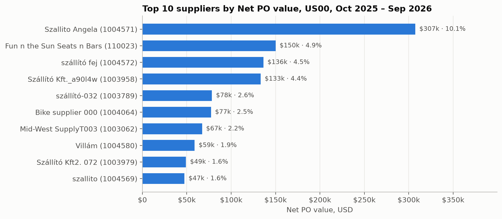
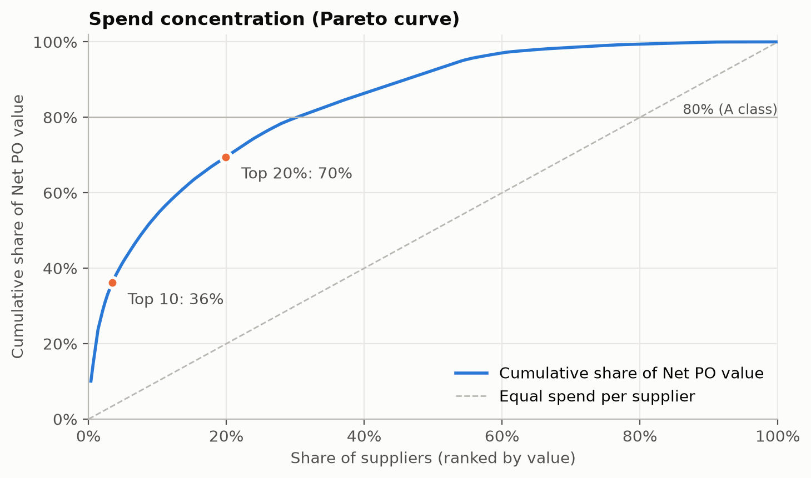

| Statistic | Value |
|---|---|
| Top 10 suppliers' share | **36.2%** |
| Top 20% (58 of 291 suppliers) share | **69.5%** |
| Largest single supplier | 10.1% (Szallito Angela) |
| HHI | 0.022 (≈ 45 equal-sized suppliers) |
| ABC classes | A: 87 suppliers = 80% of value · B: 70 = 15% · C: 134 = 5% |

**Finding.** Spend is concentrated, but less than the classic 80/20 rule, and no single supplier
dominates. 30% of suppliers make up 80% of value, and 46% of suppliers (C class) together bring only 5%.

**Decision.** The A-class suppliers are the right candidates for volume discounts and long-term
strategic contracts, as the procurement strategy intends. The long C-class tail is a candidate for
reducing the supplier base. Moderate concentration means Global Bike isn't dependent on any single
supplier overall.

#### Q5. Order pattern and consolidation candidates

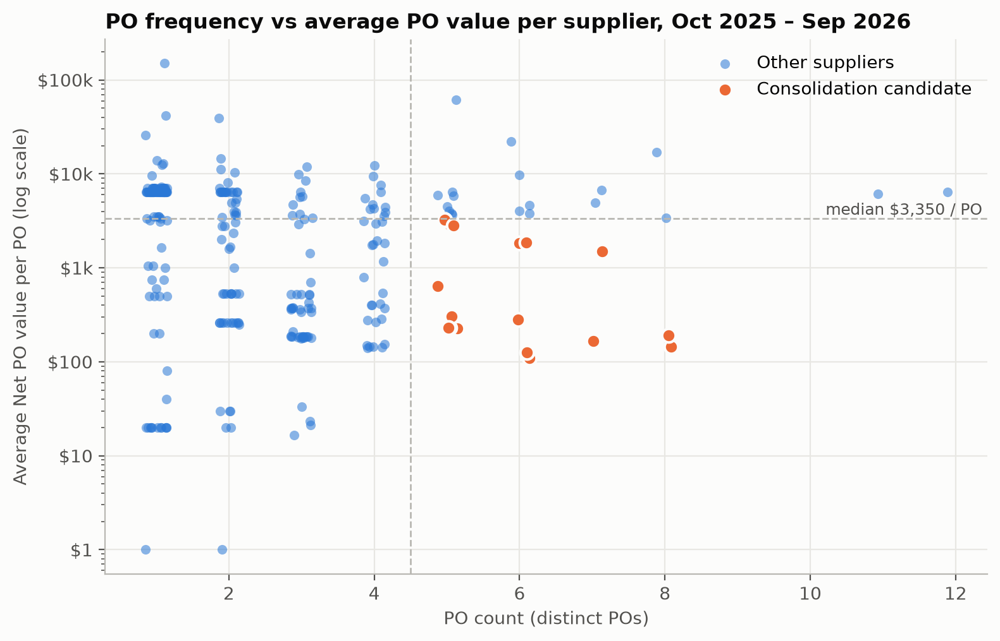

| Statistic | Value |
|---|---|
| POs per supplier | median 2, mean 2.6, max 12 |
| Suppliers with only one PO | 108 of 290 |
| Median average value per PO | $3,350 |
| Consolidation candidates (≥5 POs and below-median value per PO) | **18 suppliers**: 105 POs (**14% of POs**), $106k (**3.5% of value**) |

**Finding.** A group of 18 suppliers receives frequent small orders. Examples are Naewkamdee Nattaya
(8 POs, $144 each), Qompany (8 POs, $191 each) and Bike supplier 433 (6 POs, $110 each).

**Decision.** Replace these frequent small POs with a long-term contract or scheduling agreement and
call-off orders. That cuts the processing cost per PO and gives a basis for volume pricing.

### 3.2 Geography

#### Q2. Supplier countries and US states

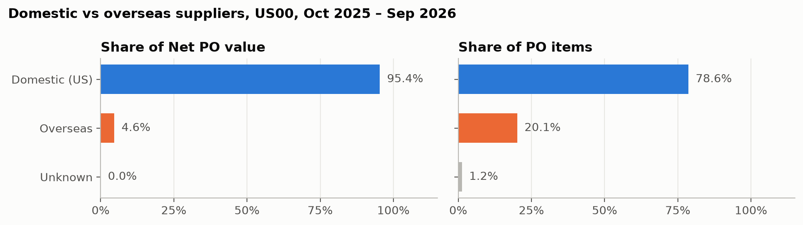
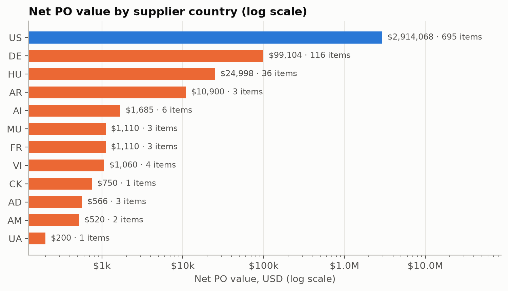
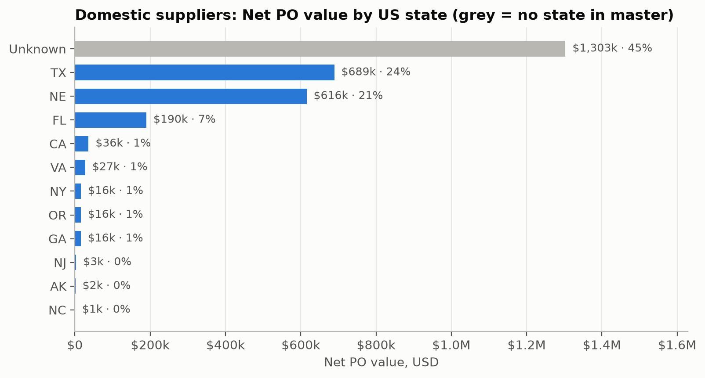

| Origin | Net PO value | Value share | PO items | Item share | Suppliers |
|---|---:|---:|---:|---:|---:|
| Domestic (US) | $2,914,068 | **95.4%** | 695 | 78.6% | 236 |
| Overseas | $142,003 | **4.6%** | 178 | 20.1% | 54 |
| Unknown (no supplier) | $0 | 0.0% | 11 | 1.2% | 0 |

Overseas value is mostly Germany ($99k, 3.2%) and Hungary ($25k, 0.8%). In the US: Texas 23.6%,
Nebraska 21.1%, Florida 6.5%, and **no state recorded 44.7%**.

**Finding.** In value terms the supplier network is almost entirely domestic. Overseas suppliers make
up 20% of order lines but under 5% of value, so they handle many small orders.

**Decision.** The procurement strategy calls for a *globally diversified* network. The data shows little
diversification by value, so Antonio should decide whether to qualify overseas sources for high-value
items rather than only small ones.

#### Q6. Receiving plant vs supplier region

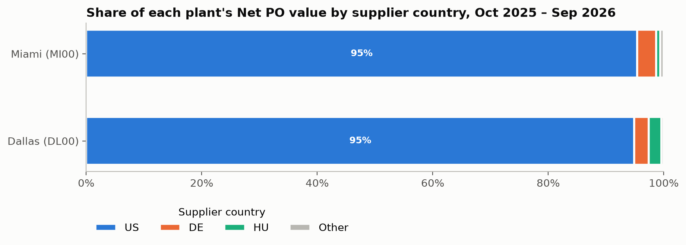
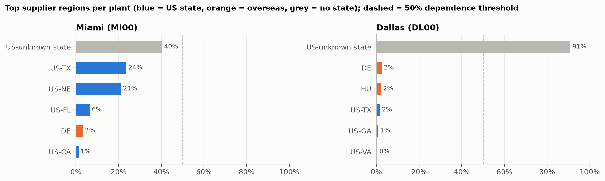

| Plant | Net PO value | US share | Largest region | Share | Dependent (>50%)? |
|---|---:|---:|---|---:|---|
| Miami MI00 | $2,914,946 | 95.4% | US, state unknown | 40% | No (then TX 24%, NE 21%) |
| Dallas DL00 | $139,054 | 94.9% | US, state unknown | **91%** | Yes, but caused by missing data |
| San Diego SD00 | $1,000 | 100% | 1 item only | – | – |

**Finding.** Both main plants source about 95% domestically. Miami's regional supply is spread out.
Dallas appears to depend on one region, but that "region" is suppliers with no state recorded.

**Decision.** At country level, both plants depend on domestic supply. Dallas's regional dependence
can't be judged yet, so completing supplier addresses is a prerequisite.

### 3.3 Time

#### Q3. Monthly Net PO value and PO count

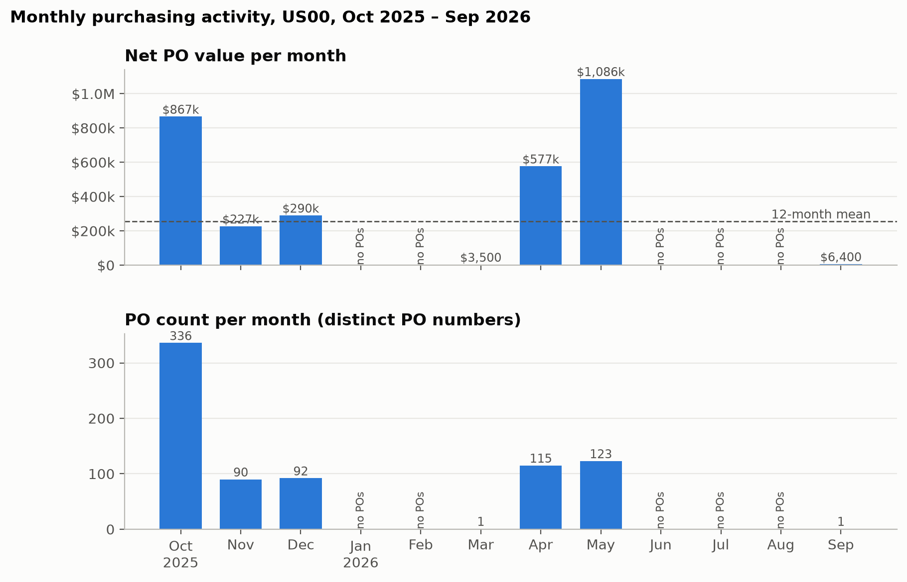

| Month | Net PO value | POs | Avg value / PO |
|---|---:|---:|---:|
| Oct 2025 | $866,571 | 336 | $2,579 |
| Nov 2025 | $226,758 | 90 | $2,520 |
| Dec 2025 | $289,926 | 92 | $3,151 |
| Jan–Feb 2026 | 0 | 0 | – |
| Mar 2026 | $3,500 | 1 | $3,500 |
| Apr 2026 | $576,520 | 115 | $5,013 |
| May 2026 | $1,086,396 | 123 | $8,832 |
| Jun–Aug 2026 | 0 | 0 | – |
| Sep 2026 | $6,400 | 1 | $6,400 |

Mean $254,673 per month vs median $4,950. **Coefficient of variation 1.51** (0.96 over the 7 active
months). **5 of 12 months have no POs.**

**Finding.** Purchasing is very bursty. Two activity peaks, Oct 2025 and Apr–May 2026, account for 83%
of the year's value. The May peak comes from larger POs (average $8.8k) rather than more POs.

**Decision.** If this pattern reflected real demand, Antonio should bundle peak-period demand into
framework contracts and agree capacity with key suppliers *before* the peaks.

#### Q7. Unit price development of the five highest-value materials

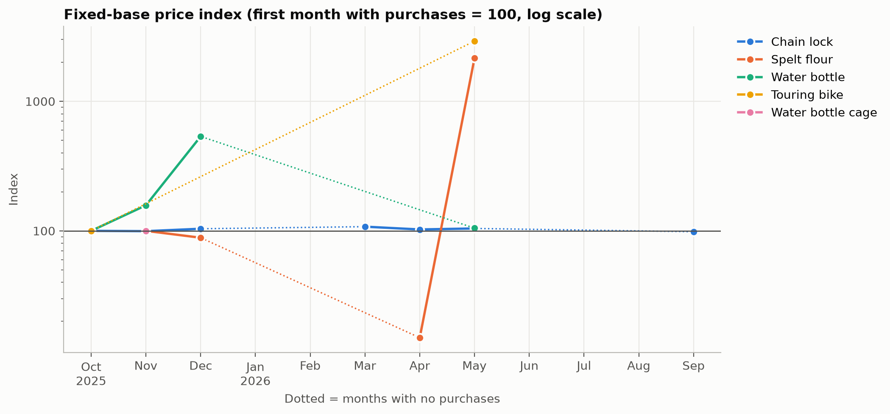
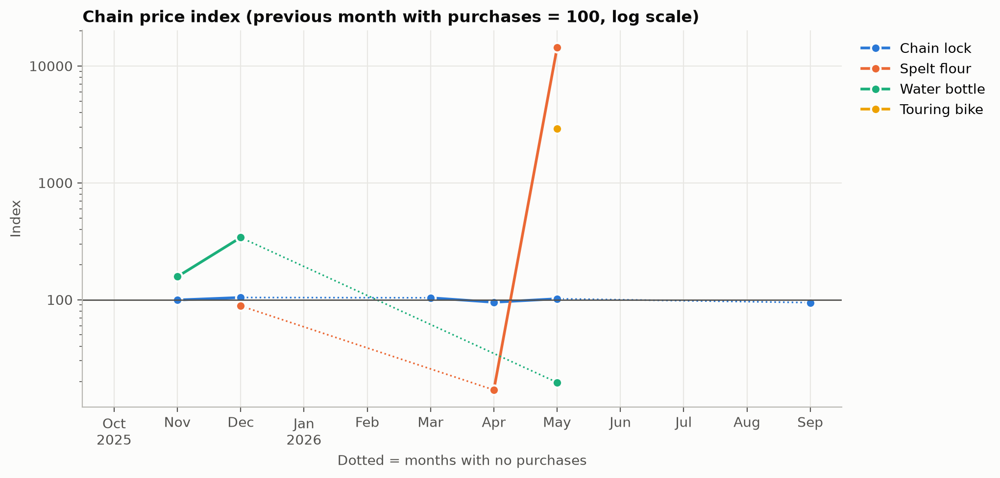
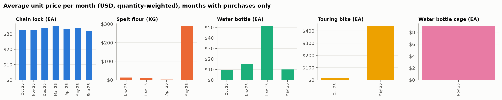

| Product family (unit) | Months with purchases | Avg unit price range | Fixed-base index | Chain index |
|---|---:|---|---|---|
| **Chain lock (EA)** | 7 | **$32.00–35.00** | 98.5–107.7 | 94.4–104.4 |
| Spelt flour (KG) | 4 | $2.00–287.86 | 15–2,153 | 16.9–14,393 |
| Water bottle (EA) | 4 | $9.53–51.07 | 100–536 | 19.6–340.5 |
| Touring bike (EA) | 2 | $15.00–437.50 | 100–2,917 | 2,917 |
| Water bottle cage (EA) | 1 | $9.00 | 100 | – |

The fixed-base index uses the first month with purchases = 100. The chain index compares each month
with the previous month that had purchases (= 100). The unit price is quantity-weighted (Σ value /
Σ quantity).

**Finding.** Chain locks, the largest spend item at 65% of value, have a stable price around $32–34 per
unit, varying within ±8% of the base. The other families jump by orders of magnitude because a few
exercise items carry made-up prices. These jumps are data entry effects, not market price changes.

**Decision.** A fixed-price long-term agreement for chain locks at about $32–33 is supported by the data.
For the other families the data can't support a price decision.

### 3.4 Additional variable: material

#### Q4. Material group and dominant suppliers in critical categories

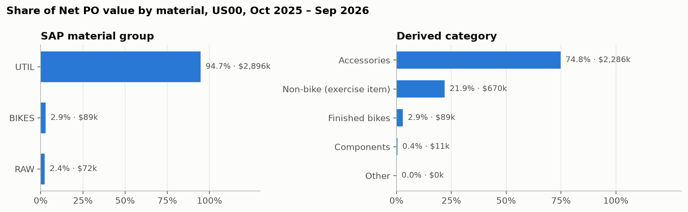
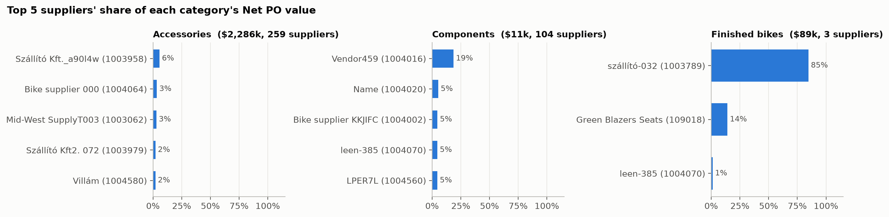

| SAP material group | Share | Derived category | Share |
|---|---:|---|---:|
| UTIL | 94.7% | Accessories | **74.8%** (chain lock alone 64.8%) |
| BIKES | 2.9% | Non-bike (exercise item) | 21.9% |
| RAW | 2.4% | Finished bikes | 2.9% |
| | | Components | 0.4% |

| Category | Net PO value | Suppliers | Top supplier share | Top 5 share | HHI |
|---|---:|---:|---:|---:|---:|
| Accessories | $2,285,690 | 259 | 6% | 16% | 0.012 |
| Components | $11,369 | 104 | 19% | 38% | 0.055 |
| **Finished bikes** | $88,550 | **3** | **85%** (szállító-032) | 100% | **0.737** |

**Finding.** The SAP material groups are too coarse to answer the question: frames, wheels and
off-road components don't appear as groups in the window. Using the derived categories, the
high-performance core (finished bikes) is a small share of value but **depends on one supplier (85%)**.
Accessories are extremely fragmented.

**Decision.** For finished bikes, qualify a second source to reduce dependence, consistent with the
strategy of reliability through long-term but not exclusive relationships. Accessories are the natural
area to consolidate into volume contracts.

#### Q8. Single-sourced vs multi-sourced materials

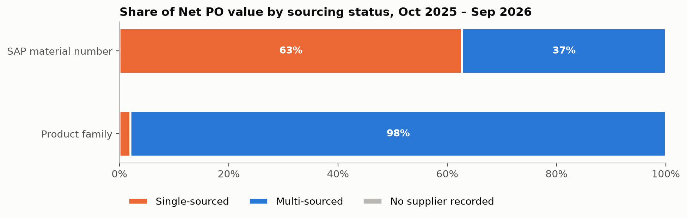

| Material definition | Single-sourced value | Multi-sourced value | Materials (single / total) |
|---|---:|---:|---|
| SAP material number | **62.7%** ($1.92M) | 37.3% | 427 / 489 |
| Product family | **2.0%** ($62k, water bottle cage) | 98.0% | 1 / 9 |

**Finding.** The answer depends on how "material" is defined. Taken literally, most value is
single-sourced. That is an artefact of each user creating their own material number for the same
product: there are 183 numbers for chain lock, supplied by 172 suppliers. By product family, real
single-sourcing is limited to the water bottle cage, plus finished bikes in practice (85% from one
supplier, Q4).

**Decision.** Put second-source qualification on the bottle cage and finished bikes. Harmonise material
numbers in the material master so that sourcing, price comparison and contracts work across suppliers.

---

## 4. Summary for Antonio

| Area | What the data supports | What it can't tell (yet) |
|---|---|---|
| Supplier | ~87 A-class suppliers = 80% of value, where long-term contracts make sense. 18 suppliers with many small POs to consolidate. | Which supplier is *best*: there is no quality, reliability or lifecycle-cost data. |
| Geography | 95% domestic by value. Overseas suppliers handle many small orders. | Supply risk: the address isn't the ship-from location, and 45% of US value has no state. |
| Time | Purchasing comes in bursts with 5 empty months. Chain-lock prices are stable at $32–35. | Seasonality: one year of training data isn't enough. |
| Material | Finished bikes depend 85% on one supplier, and the bottle cage is single-sourced. | Equivalence of alternative suppliers: qualification data is needed. |

**Additional data Antonio needs before changing a supplier relationship:**
1. **Quality**: QM inspection lots, rejection and return rates per supplier and material.
2. **Delivery reliability**: goods-receipt dates (EKBE) compared with scheduled delivery dates (EKET).
3. **Total cost of ownership**: invoiced vs ordered prices (EKBE/RBKP), freight, warranty and lifecycle
   costs.
4. **Master data**: complete supplier addresses (state, ship-from), a harmonised material master and a
   meaningful material group hierarchy (frames, wheels, components, accessories).
5. **History**: at least 2–3 years of production data (outside the training client) to test seasonality
   and price trends.

---

## 5. Use of AI tools

The project was carried out with the support of an AI coding agent (Claude Code), with a clear split of
responsibilities:

- **Human (team):** designed the project architecture (workflow, folder structure, one notebook per
  table and per question), **formulated the analytical questions** and the scope (US00, reporting period,
  measures), and **interpreted the data**: the business findings, decisions and limitations in this report
  are our own.
- **AI agent:** delegated the repetitive, monotonous coding work under our direction: boilerplate code for
  loading and caching the Excel exports, routine EDA checks (missing values, value counts, grain checks),
  pandas aggregations and the matplotlib plotting code for the charts.

All code was reviewed and run by the team, and every number in this report was checked against the
notebook outputs.

---

*Source code and notebooks: `src/eda/` (exploratory data analysis) and `src/analysis/q1 … q8`
(one notebook per question). Charts: `reports/figures/`.*
